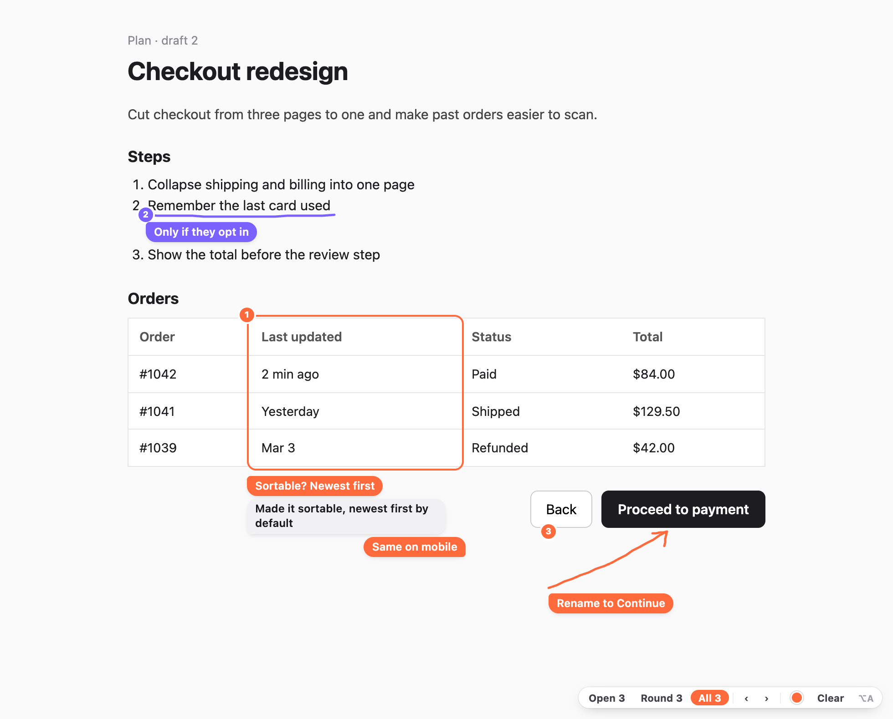

# annot

The simplest browser annotation tool for human–machine communication.

Draw on any page in Chrome and type a note. Your coding agent reads the note along with exactly what you pointed at, makes the change, and replies under your mark.



Say you're reviewing a plan your agent wrote as HTML, or the app it's building. Instead of describing "the date column in the orders table" in chat, you draw a box around it and type. Your agent (Claude Code, Codex, or anything that can run a command) runs `annot pull` and gets:
- your note;
- the DOM elements you marked, with their selectors and text;
- the exact words you underlined, or what your arrow points at;
- a screenshot.

It makes the change and answers with `annot resolve`. The answer shows up as a bubble under your mark.

- **Nothing to learn:** ⌥A, drag, type, Enter. Shift-drag to circle, underline or draw an arrow.
- **Any page:** local HTML files, localhost, and hosted apps you're signed into.
- **Local:** marks are plain files in `~/.annotations`. There's no server and no account, and nothing to install at runtime beyond Node.

## Install

Requires Chrome and Node 20+ on macOS or Linux.

```sh
git clone https://github.com/asaeed/annot && cd annot
./install.sh host     # lets the extension save marks; puts the `annot` CLI in ~/.local/bin
./install.sh claude   # agent skill for Claude Code; `./install.sh codex` for Codex
```

Then, in Chrome:
1. Open `chrome://extensions` and turn on **Developer mode**.
2. Click **Load unpacked** and pick the `extension/` folder.
3. To mark up local HTML files, open annot's **Details** and turn on **Allow access to file URLs**.

Chrome starts the native host without your shell's PATH, so `install.sh host` writes in an absolute Node path. It uses fnm's default Node if there is one, otherwise the `node` on your PATH. Set `ANNOT_NODE=/path/to/node` to choose another.

## Use

| | |
|---|---|
| ⌥A or the toolbar icon | annotate mode on/off |
| drag | draw a box |
| Shift + drag | freehand: circle, underline or arrow. Keep Shift-dragging to add strokes to the same drawing |
| Enter / Shift+Enter | save / new line |
| Esc | close the picker or confirmation, cancel the current mark, or leave annotate mode |
| ⌘Z | remove the last stroke of a drawing you're still making, or undo your last save, delete or Clear on this page (refused if an agent has replied since). In a note with text, it undoes typing |
| click a mark or its bubbles | edit its note. Once the agent has replied, type a follow-up instead; the original note stays as written. **delete** removes the mark |
| ‹ › in the bar | scroll to the previous / next mark, in page order |
| color dot in the bar | pick a color, or one you've used before |
| Clear in the bar | delete every mark on this page, after a confirmation |

Drawings are recognised when you save, so the agent gets the right target:

| You draw | annot reads it as | Target |
|---|---|---|
| a closed loop | circle | the elements inside it |
| a flat line | underline | the exact words above it |
| a long stroke, with or without short strokes at one end | arrow | the first element in the direction it points |
| anything else | drawing | the elements under it, plus the screenshot |

The longest stroke of an arrow is its shaft and the short strokes mark its tip, so the order you draw them in doesn't matter.

The bar filters **Open**, **Round** (marks since your agent last pulled) and **All**. Outside annotate mode, marks are hidden and the toolbar badge shows how many are open on the page.

## With your agent

Tell your agent to "check my annotations". The skill has it run:

```sh
annot pull [url-prefix] [--all]   # open marks as JSON; "new": true means added or changed since the last pull
annot resolve <id> [reply...]     # resolve a mark with a one-line reply
```

Here's the arrow from the screenshot as `annot pull` returns it, trimmed:

```json
{
  "id": "mwucbvl5qssf",
  "n": 3,
  "url": "http://localhost:5173/plan",
  "shape": "arrow",
  "text": "Rename to Continue",
  "tip": { "x": 732, "y": 584, "dx": 0.87, "dy": -0.49 },
  "elements": [
    { "selector": "#next", "tag": "button", "text": "Proceed to payment", "rect": { "x": 660, "y": 539, "w": 180, "h": 41 } }
  ],
  "status": "open",
  "thread": [],
  "capture": "~/.annotations/localhost:5173/mwucbvl5qssf.png",
  "new": true
}
```

`thread` holds the conversation after your note, oldest first: the agent's replies and your follow-ups. Form fields only ever report their placeholder or name, never what's typed in them. [skill.md](skill.md) is the guide the agent follows, and [PLAN.md](PLAN.md) has the full data format.

While you're working on a mark, `annot pull` also returns it as a draft (`status: "draft"`) once you finish a stroke, so the agent can see what you're pointing at before you press Enter.

Codex in `workspace-write` mode can read marks but not write them. Add `~/.annotations` to `writable_roots` under `[sandbox_workspace_write]` in its `config.toml` so `annot resolve` works without approval prompts.

## How it works

```
page ── overlay.js (content script; marks drawn in a shadow DOM)
          │
        background.js (toggle, screenshot, badge)
          │ native messaging
        bin/annot.js ── ~/.annotations/<host>/<id>.json + <id>.png
                                  │
        annot pull / annot resolve (the same script, run as a CLI)
```

Each mark is one JSON file, so the extension and the CLI never write the same file at once. Chrome starts the host only for the moment it needs it, so nothing keeps running in the background.

## Limits

- Chrome only.
- Marks are placed at page coordinates. Inside scrolling panels, iframes or canvas apps, or after the layout changes, they can drift. The element data still tells the agent what you meant.
- Marks are stored per host and path, so routes that differ only by `#hash` share marks.

## Develop

```sh
npm install && npx playwright install chromium   # only needed for the end-to-end test
npm test                                         # store and native host tests, plus an end-to-end run in Chromium
```

During development annot reloads itself. If `manifest.json` or `background.js` has changed on disk, the next ⌥A reloads the extension and then opens annotate mode. `overlay.js` and `shapes.js` are read fresh on every ⌥A anyway. This needs Developer mode on, which it is if you loaded annot unpacked, and it will be removed before a release.

## License

MIT
