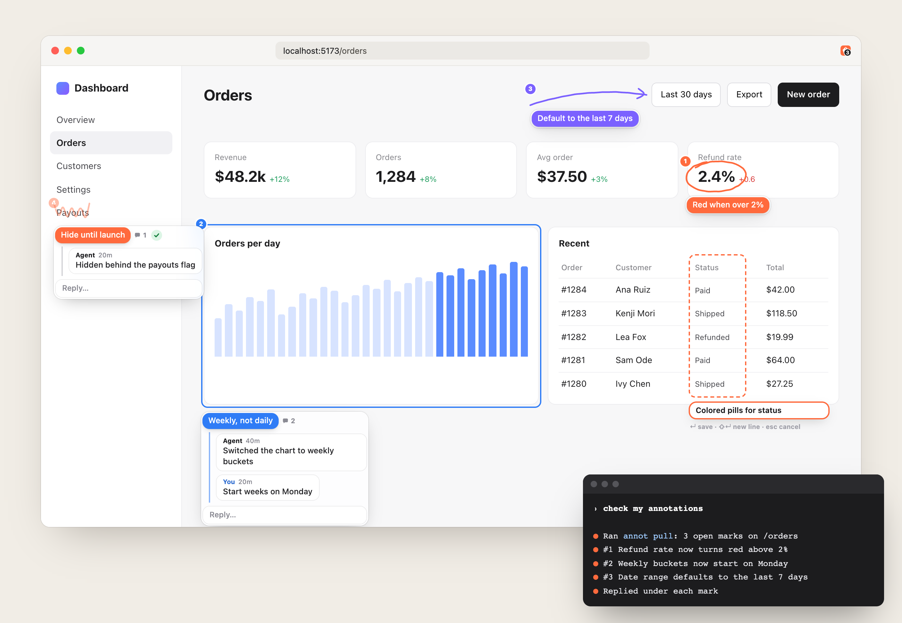
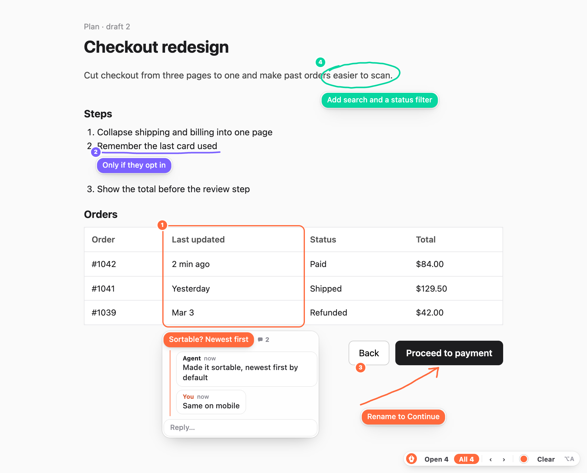

<h1></h1>

The simplest browser annotation tool for human–machine communication.

Draw on any page in your browser (Chrome, Brave or Edge) and type a note. Your coding agent reads the note along with exactly what you pointed at, makes the change, and replies under your mark.



Say you're reviewing a plan your agent wrote as HTML, or the app it's building. Instead of describing "the date column in the orders table" in chat, you draw a box around it and type. Your agent (Claude Code, Codex, or anything that can run a command) runs `annot pull` and gets:
- your note;
- the DOM elements you marked, with their selectors and text;
- the exact words under your mark;
- a screenshot with your mark drawn on it, so it can see whether you circled, underlined or pointed.

It makes the change and answers with `annot resolve`. The answer shows up in a thread under your mark.

- **Nothing to learn:** ⌥A, drag, type, Enter. Shift-drag to circle, underline or draw an arrow.
- **Any page:** local HTML files, localhost, and hosted apps you're signed into.
- **Local:** marks are plain files in `~/.annotations`. There's no server and no account, and nothing to install at runtime beyond Node.

## Install

Requires Chrome, Brave or Edge, and Node 20+, on macOS or Linux.

```sh
git clone https://github.com/asaeed/annot && cd annot
./install.sh host     # lets the extension save marks; puts the `annot` CLI in ~/.local/bin
./install.sh claude   # agent skill for Claude Code; `./install.sh codex` for Codex
```

Then, in your browser:
1. Open the extensions page (`chrome://extensions`, `brave://extensions` or `edge://extensions`) and turn on **Developer mode**.
2. Click **Load unpacked** and pick the `extension/` folder.
3. To mark up local HTML files, open annot's **Details** and turn on **Allow access to file URLs**.

`install.sh host` registers the native host with each of these browsers that's installed; run it again if you add one later. The browser starts it without your shell's PATH, so it gets an absolute Node path. It uses fnm's default Node if there is one, otherwise the `node` on your PATH. Set `ANNOT_NODE=/path/to/node` to choose another.

## Use

| | |
|---|---|
| ⌥A or the toolbar icon | annotate mode on/off |
| drag | draw a box |
| Shift + drag | freehand: circle, underline or arrow. Keep Shift-dragging to add strokes to the same drawing |
| Enter / Shift+Enter | save / new line |
| Esc | close the picker or confirmation, cancel the current mark, or leave annotate mode |
| ⌘Z | remove the last stroke of a drawing you're still making, or undo your last save, delete or Clear on this page (refused if an agent has replied since). In a note with text, it undoes typing |
| click a mark | edit its note. Once the agent has replied, type a follow-up instead (or click **Reply…** under the replies); the original note stays as written. **delete** removes the mark |
| click a note that has replies | fold its thread to one line, showing the reply count and a check once resolved, or open it again |
| ‹ › in the bar | scroll to the previous / next mark, in page order |
| color dot in the bar | pick a color, or one you've used before |
| Clear in the bar | delete every mark on this page, after a confirmation |

annot doesn't try to work out what you drew. A drawing is saved as its strokes, the elements and words within 20px of it, and the screenshot. Your agent looks at the screenshot to tell a circle from an underline or an arrow, the way a person would. So draw whatever makes your point, in as many strokes as you like.



The bar in the bottom-right corner filters **Open** and **All**. The toolbar icon turns into an orange tile with a white nib while annotate mode is on, and the number on its corner is how many marks are open on the page. Outside annotate mode, marks are hidden. Coming back to the tab (say, from your terminal) picks up the agent's replies; no need to reopen anything.

If the page layout changes after you mark it, for example because the agent edited the page, each mark moves with the element it was drawn on.

## With your agent

Tell your agent to "check my annotations". The skill has it run:

```sh
annot pull [url-prefix] [--all]   # open marks as JSON; "new": true means added or changed since the last pull
annot resolve <id> [reply...]     # resolve a mark with a one-line reply
```

Here's the underline from the checkout sample above as `annot pull` returns it, trimmed:

```json
{
  "id": "mww2fkeightj",
  "n": 2,
  "url": "http://localhost:5173/plan",
  "kind": "stroke",
  "text": "Only if they opt in",
  "quote": "Remember the last card used",
  "elements": [
    { "selector": "#card", "tag": "li", "text": "Remember the last card used", "rect": { "x": 162, "y": 232, "w": 678, "h": 23 } }
  ],
  "status": "open",
  "thread": [],
  "capture": "~/.annotations/localhost:5173/mww2fkeightj.png",
  "new": true
}
```

`thread` holds the conversation after your note, oldest first: the agent's replies and your follow-ups. Form fields only ever report their placeholder or name, never what's typed in them. [skill.md](skill.md) is the guide the agent follows, and [PLAN.md](PLAN.md) has the full data format.

While you're working on a mark, `annot pull` also returns it as a draft (`status: "draft"`) once you finish a stroke, so the agent can see what you're pointing at before you press Enter.

Codex in `workspace-write` mode can read marks but not write them. Add `~/.annotations` to `writable_roots` under `[sandbox_workspace_write]` in its `config.toml` so `annot resolve` works without approval prompts.

## How it works

```
page ── overlay.js (content script; marks drawn in a shadow DOM)
          │
        background.js (toggle, screenshot, toolbar icon)
          │ native messaging
        bin/annot.js ── ~/.annotations/<host>/<id>.json + <id>.png
                                  │
        annot pull / annot resolve (the same script, run as a CLI)
```

Each mark is one JSON file, so the extension and the CLI never write the same file at once. The browser starts the host only for the moment it needs it, so nothing keeps running in the background.

## Limits

- Chromium browsers only: Chrome, Brave and Edge. Firefox runs extensions differently (no background service worker, its own native messaging setup, and signing to install), so it isn't supported yet.
- Marks follow their element when it moves, but not when it's resized, removed or no longer recognisable. Then they stay where you drew them, and so do marks inside scrolling panels, iframes and canvas apps. The element data still tells the agent what you meant.
- Marks are stored per host and path, so routes that differ only by `#hash` share marks.

## Develop

```sh
npm install && npx playwright install chromium   # only needed for the end-to-end test
npm test                                         # store and native host tests, plus an end-to-end run in Chromium
```

During development annot reloads itself. If `manifest.json` or `background.js` has changed on disk, the next ⌥A reloads the extension and then opens annotate mode. `overlay.js` is read fresh on every ⌥A anyway. This needs Developer mode on, which it is if you loaded annot unpacked, and it will be removed before a release.

`design/` has the explorations behind the overlay, icon and logo; open its HTML files in a browser.

## License

MIT
